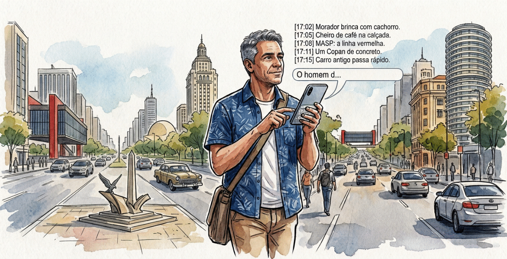

# Manual do Taquígrafo

## 1. Apresentação

O Taquígrafo é um aplicativo para registrar o que acontece ao seu redor em frases curtas, cada uma carimbada com a hora exata, funcionando inteiramente sem internet. Este manual explica, passo a passo, como instalar, usar e manter o aplicativo.

  

### A ideia: taquigrafia temporal urbana

A taquigrafia clássica serve para anotar a fala na velocidade em que ela acontece. O Taquígrafo transfere esse princípio para o tempo da cidade. Em vez de transcrever falas, você registra micro-notas de até 50 caracteres enquanto caminha, espera um ônibus, observa uma rua ou acompanha um evento. Cada nota recebe automaticamente um carimbo de hora no formato HH:MM:SS. Ao final, você tem uma linha do tempo fiel do seu percurso.

O limite de 50 caracteres é proposital. Ele obriga a escolher o essencial, evita que você pare por muito tempo para escrever e produz registros fáceis de ler depois.

### Para quem serve

- Pesquisadores e estudantes que fazem observação de campo urbana.
- Jornalistas e fotógrafos que precisam reconstruir a ordem dos acontecimentos.
- Pessoas que querem acompanhar o próprio dia, um deslocamento ou uma atividade.
- Qualquer pessoa que queira entregar suas notas a uma inteligência artificial para análise.

### O que o aplicativo oferece

- **Cadernos:** cada atividade tem seu caderno, com nome, status e contagem de notas.
- **Sessões controladas:** o registro só é liberado depois de você iniciar a sessão e é encerrado quando você conclui o caderno.
- **Exportação:** arquivo TXT, texto pronto para IA e impressão de um relatório limpo.
- **Backup geral:** todos os cadernos em um único arquivo JSON, com restauração por arquivo.
- **Uso offline:** depois do primeiro carregamento, nada depende de conexão.
- **Temas claro e escuro**, tela cheia e instalação como aplicativo no celular ou no computador.

## 2. Instalação e primeiro acesso

Você pode usar o Taquígrafo direto no navegador ou instalá-lo como aplicativo; nos dois casos o primeiro acesso exige internet, e depois disso o app funciona offline.

### Abrir no navegador

1. Acesse https://magpe-stack.github.io/Taquigrafo/ em um navegador atual (Chrome, Edge, Firefox, Safari ou equivalente).
2. Aguarde a tela de abertura, que dura cerca de 3 segundos.
3. Espere o carregamento completo antes de desligar a internet. Nesse momento o aplicativo guarda seus arquivos para uso offline.

### Instalar como aplicativo

Instalar não é obrigatório, mas deixa o Taquígrafo com ícone próprio, em janela separada e fácil de abrir durante um deslocamento.

- **Pelo menu do Taquígrafo:** abra o menu lateral e, se aparecer o botão **Instalar o Taquígrafo**, toque nele e confirme. O botão só aparece quando o navegador oferece a instalação.
- **Chrome ou Edge no computador:** use o ícone de instalação na barra de endereço ou o menu do navegador, na opção de instalar o aplicativo.
- **Chrome no Android:** menu do navegador, opção de instalar aplicativo ou adicionar à tela inicial.
- **Safari no iPhone ou iPad:** botão de compartilhar, opção **Adicionar à Tela de Início**. O Safari não exibe o botão de instalação do menu do Taquígrafo.

Depois de instalado, o aplicativo abre pelo ícone na tela inicial ou na lista de programas, sem barra de endereço.

### A tela de abertura

Ao abrir o aplicativo, uma tela azul mostra o símbolo do Taquígrafo com um efeito de aproximação e esmaecimento por 3 segundos. Ela aparece no celular e no computador. Em seguida, você chega à tela **Meus Cadernos**. Se o seu sistema estiver configurado para reduzir animações, o efeito de zoom é suprimido, mas a tela continua visível pelo mesmo tempo.

## 3. Conhecendo a interface

A interface tem quatro áreas fixas: cabeçalho no topo, menu lateral que desliza da direita, área de conteúdo no centro e rodapé com três atalhos.

### Cabeçalho

No canto esquerdo ficam o símbolo do aplicativo e o nome **Taquígrafo**. Tocar nesse conjunto leva você imediatamente à tela inicial, **Meus Cadernos**, de qualquer ponto do aplicativo. No canto direito está o botão de menu, com três traços horizontais.

### Menu lateral

O botão de três traços abre um painel que desliza pela lateral direita. Para fechá-lo, use o botão de fechar no topo do painel, toque na área escurecida fora dele ou pressione a tecla Esc. O painel contém:

| Botão | O que faz |
| --- | --- |
| Meus Cadernos | Volta à lista de cadernos |
| Novo Caderno | Abre a janela para criar um caderno |
| Backup Geral (JSON) | Baixa todos os cadernos em um arquivo |
| Restaurar Backup | Importa cadernos de um arquivo de backup |
| Alternar Tema Claro/Escuro | Troca a aparência do aplicativo |
| Tela Cheia | Ocupa a tela inteira; muda para Sair da Tela Cheia |
| Sobre o App | Explica a origem do nome e a proposta |
| Instalar o Taquígrafo | Aparece só quando a instalação está disponível |

### Tela Meus Cadernos

É a tela inicial. Mostra os cadernos como cartões, do mais recente para o mais antigo. Cada cartão traz o nome da atividade, o status, a quantidade de notas, a data de criação e os botões **Abrir** e **Excluir**. No alto há o botão **+ Novo Caderno**. Sem nenhum caderno, aparece uma mensagem convidando você a criar o primeiro.

### Rodapé fixo

O rodapé permanece visível em todas as telas e tem três botões que abrem uma nova aba:

- **App:** o símbolo do aplicativo, que leva ao endereço oficial do Taquígrafo.
- **GitHub:** o ícone de gatinho, que leva ao repositório do projeto.
- **Ajuda:** ícone de interrogação, que leva ao arquivo README com instruções.

Em telas estreitas, como a de um celular, os rótulos de texto desaparecem e ficam apenas os ícones.
